# Cisco & FortiGate Network Lab (EVE-NG)

A small enterprise network with a redundant core/access design and a FortiGate edge firewall, built and tested in EVE-NG. The two core switches provide HSRP gateway redundancy, a Layer 2 EtherChannel and Rapid PVST+, and peer with the FortiGate over OSPF. The FortiGate originates the default route and performs NAT to the Internet.

**Designed and implemented by Chanathip Artwichian**

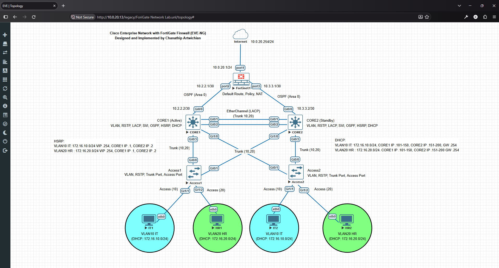

---

## Table of Contents

1. [Objectives](#objectives)
2. [Platform and Devices](#platform-and-devices)
3. [Addressing Plan](#addressing-plan)
4. [Device Roles](#device-roles)
5. [Design Summary](#design-summary)
6. [Verification and Test Results](#verification-and-test-results)
7. [Repository Structure](#repository-structure)
8. [Possible Improvements](#possible-improvements)

---

## Objectives

- Build a redundant core/access network with two core switches and two access switches
- Provide gateway redundancy for each VLAN with HSRP
- Run OSPF between the cores and the FortiGate, with the FortiGate advertising the default route
- Provide Internet access to all VLANs through FortiGate firewall policy and NAT
- Verify the design with show commands and end-to-end connectivity tests

## Platform and Devices

The lab runs in EVE-NG, hosted as a virtual machine on Proxmox.

| Role | Device | Image |
|---|---|---|
| Edge firewall | FortiGate | FortiGate VM 7.0.9 |
| Core switches | CORE1, CORE2 | Cisco IOS (L3) |
| Access switches | Access1, Access2 | Cisco IOS (L2) |
| Clients | IT1, HR1, IT2, HR2 | Virtual PCs |
| Internet | Cloud (10.0.20.0/24 network, gateway 10.0.20.254) | EVE-NG Cloud |

## Addressing Plan

### Subnets

| Purpose | Subnet |
|---|---|
| WAN (FortiGate to Internet) | 10.0.20.0/24 (gateway 10.0.20.254) |
| FortiGate to CORE1 | 10.2.2.0/30 |
| FortiGate to CORE2 | 10.3.3.0/30 |
| VLAN 10 (IT) | 172.16.10.0/24 |
| VLAN 20 (HR) | 172.16.20.0/24 |

### Device Addresses

| Device | Interface | Address | Connected to |
|---|---|---|---|
| FortiGate | port1 | 10.0.20.1/24 | Internet |
| FortiGate | port2 | 10.2.2.1/30 | CORE1 Gi0/0 |
| FortiGate | port3 | 10.3.3.1/30 | CORE2 Gi0/0 |
| CORE1 | Gi0/0 | 10.2.2.2/30 | FortiGate port2 |
| CORE2 | Gi0/0 | 10.3.3.2/30 | FortiGate port3 |

### VLANs, HSRP and DHCP

| VLAN | Name | Subnet | HSRP virtual IP (gateway) | CORE1 | CORE2 | DHCP range on CORE1 | DHCP range on CORE2 |
|---|---|---|---|---|---|---|---|
| 10 | IT | 172.16.10.0/24 | 172.16.10.254 | .1 | .2 | .101 - .150 | .151 - .200 |
| 20 | HR | 172.16.20.0/24 | 172.16.20.254 | .1 | .2 | .101 - .150 | .151 - .200 |

### Switch Port Map

| Link | Port A | Port B | Mode |
|---|---|---|---|
| CORE1 to CORE2 (Po1, LACP) | CORE1 Gi0/1-2 | CORE2 Gi0/1-2 | Trunk (VLAN 10, 20) |
| CORE1 to Access1 | CORE1 Gi0/3 | Access1 Gi0/0 | Trunk (VLAN 10, 20) |
| CORE1 to Access2 | CORE1 Gi1/0 | Access2 Gi0/1 | Trunk (VLAN 10, 20) |
| CORE2 to Access1 | CORE2 Gi1/0 | Access1 Gi0/1 | Trunk (VLAN 10, 20) |
| CORE2 to Access2 | CORE2 Gi0/3 | Access2 Gi0/0 | Trunk (VLAN 10, 20) |
| Access1 to IT1 | Access1 Gi1/1 | IT1 eth0 | Access (VLAN 10) |
| Access1 to HR1 | Access1 Gi1/2 | HR1 eth0 | Access (VLAN 20) |
| Access2 to IT2 | Access2 Gi1/1 | IT2 eth0 | Access (VLAN 10) |
| Access2 to HR2 | Access2 Gi1/2 | HR2 eth0 | Access (VLAN 20) |

## Device Roles

| Device | Layer | Main role |
|---|---|---|
| FortiGate | Perimeter / security | Edge firewall, NAT, OSPF, originates the default route |
| CORE1 | Core (L3) | STP root, HSRP Active, VLAN gateway (SVIs), OSPF, DHCP |
| CORE2 | Core (L3) | Secondary root, HSRP Standby, VLAN gateway (SVIs), OSPF, DHCP |
| Access1, Access2 | Access (L2) | Access ports for clients, trunk ports to both cores |
| IT1, HR1, IT2, HR2 | End devices | Request addresses via DHCP, used for connectivity tests |

## Design Summary

| Feature | Implementation |
|---|---|
| VLANs | VLAN 10 (IT) and VLAN 20 (HR) on all four switches |
| Trunking | 802.1Q trunks from each access switch to both cores (dual-homed) |
| EtherChannel | LACP bundle (Po1) between CORE1 and CORE2 |
| Spanning Tree | Rapid PVST+; CORE1 is root for both VLANs (priority 24576), CORE2 is the secondary (priority 28672) |
| Gateway redundancy | HSRP per VLAN; CORE1 Active (priority 100), CORE2 Standby (priority 90), preempt enabled |
| DHCP | Configured on both cores with non-overlapping ranges (.101-.150 and .151-.200) |
| Routing | OSPF Area 0 between each core and the FortiGate |
| Default route | Originated by the FortiGate (via 10.0.20.254) and learned by the cores through OSPF |
| Internet access | FortiGate firewall policy with NAT on the WAN interface (port1) |

Inter-VLAN traffic between VLAN 10 and VLAN 20 is routed on the core switches and does not pass through the FortiGate. The FortiGate protects the perimeter and handles all Internet-bound traffic.

Full device configurations are in the [`03-configs/`](03-configs/) folder (sensitive values have been redacted).

## Verification and Test Results

### Core Switches (CORE1 and CORE2)

**Interface status** (`show ip interface brief`)

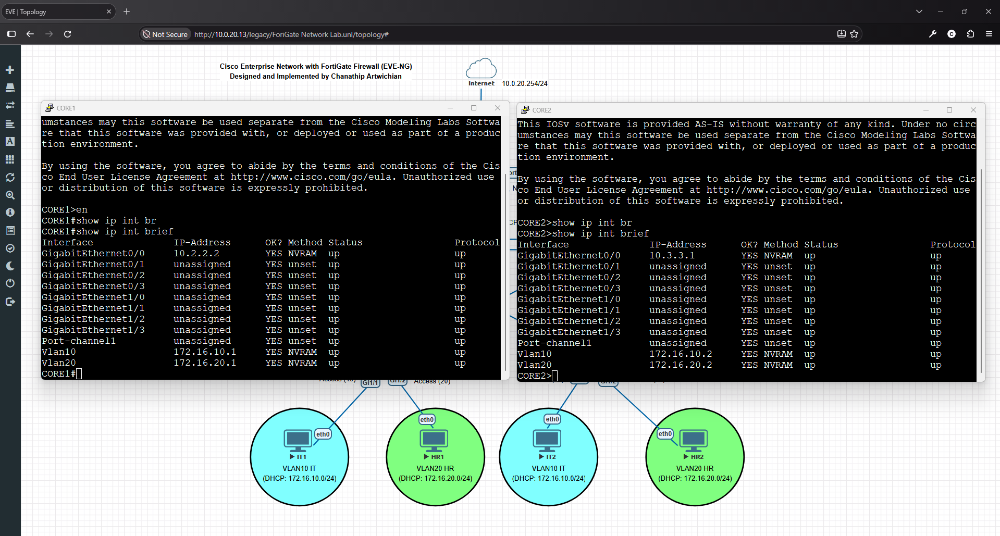

**EtherChannel** (`show etherchannel summary`)

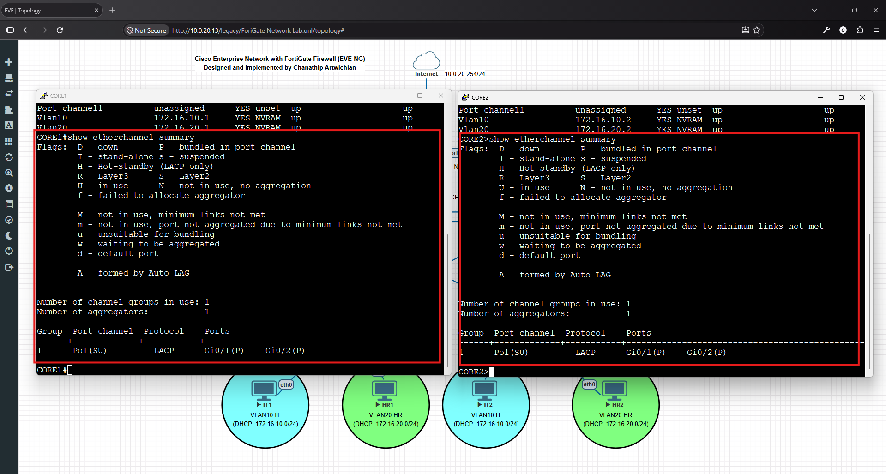

**Trunk ports** (`show interfaces trunk`)

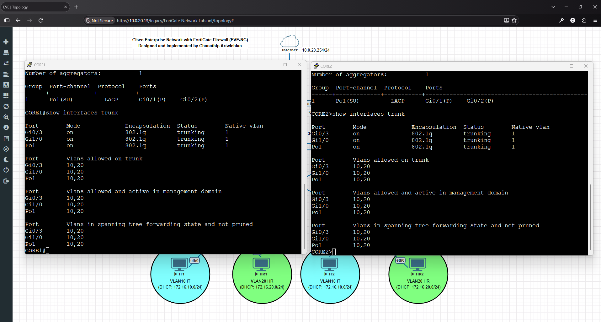

**Spanning Tree root** (`show spanning-tree`) shows CORE1 as the root bridge for VLAN 10 and VLAN 20, with CORE2 reaching the root through Po1.

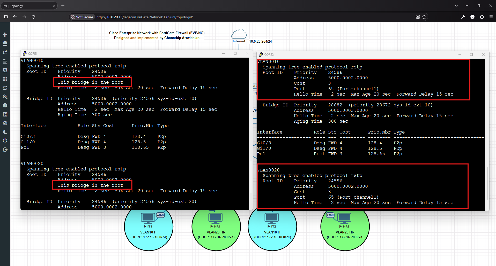

**HSRP** (`show standby brief`) shows CORE1 as Active and CORE2 as Standby for both VLANs, with virtual IPs 172.16.10.254 and 172.16.20.254.

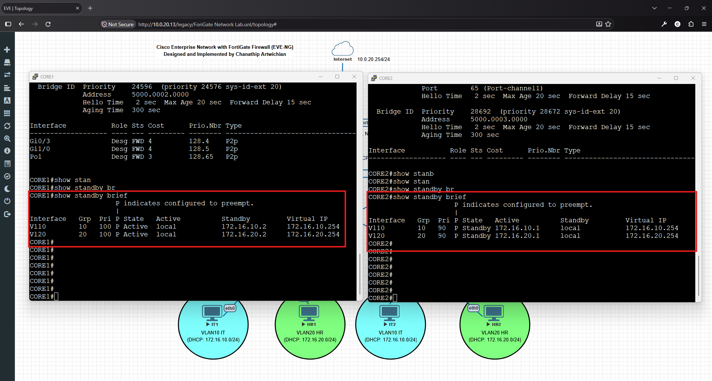

**DHCP pools** (`show ip dhcp pool`)

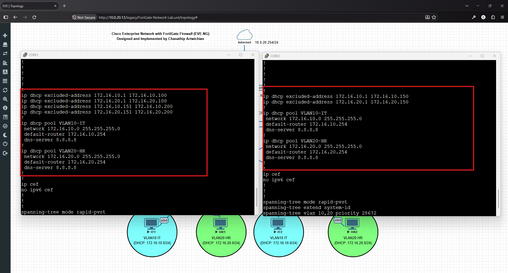

**OSPF neighbors** (`show ip ospf neighbor`)

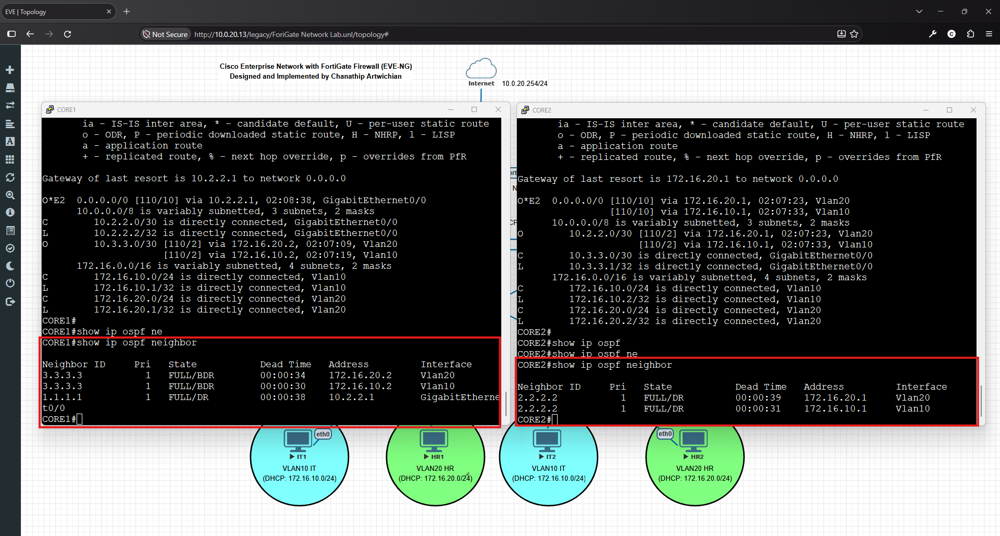

**OSPF routes**, including the default route from the FortiGate (`show ip route ospf`)

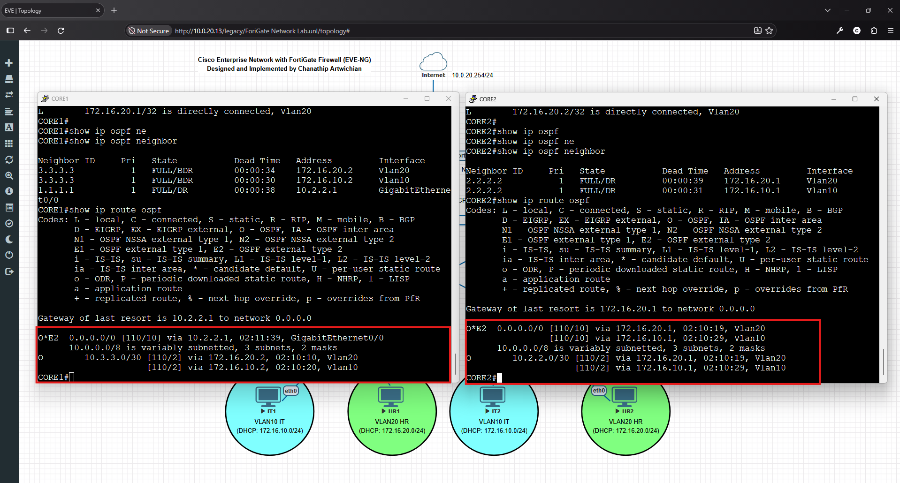

### Access Switches (Access1 and Access2)

**VLANs and access ports** (`show vlan brief`)

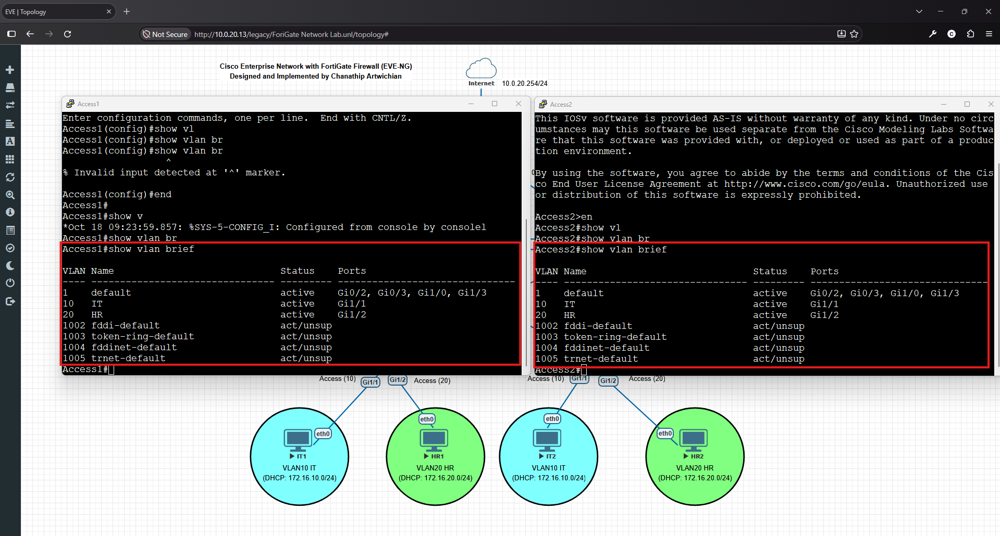

**Trunk ports to both cores** (`show interfaces trunk`)

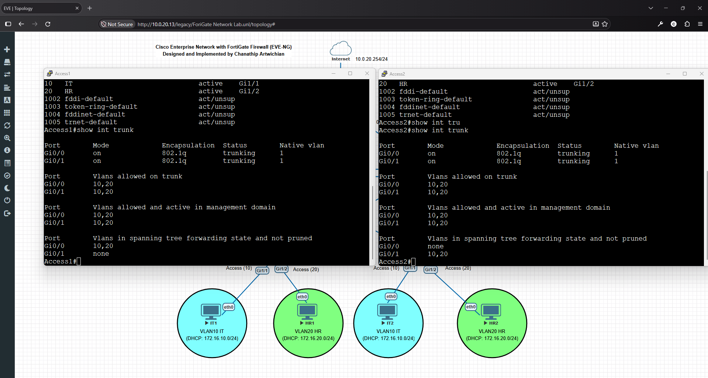

### FortiGate

**Interfaces**

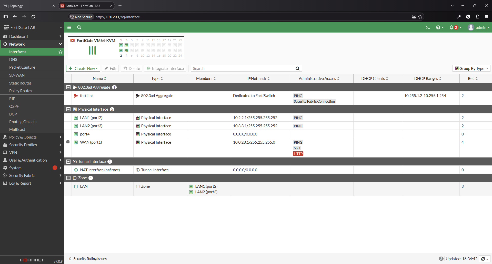

**OSPF neighbors** (`get router info ospf neighbor`)

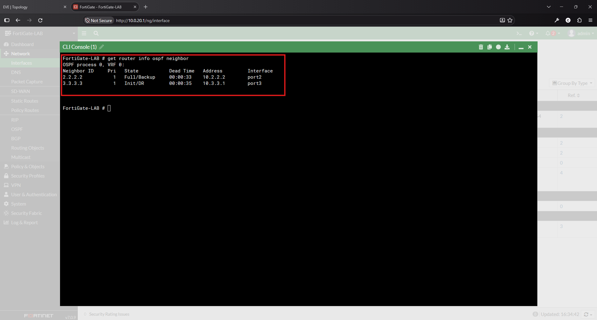

**Routing monitor**

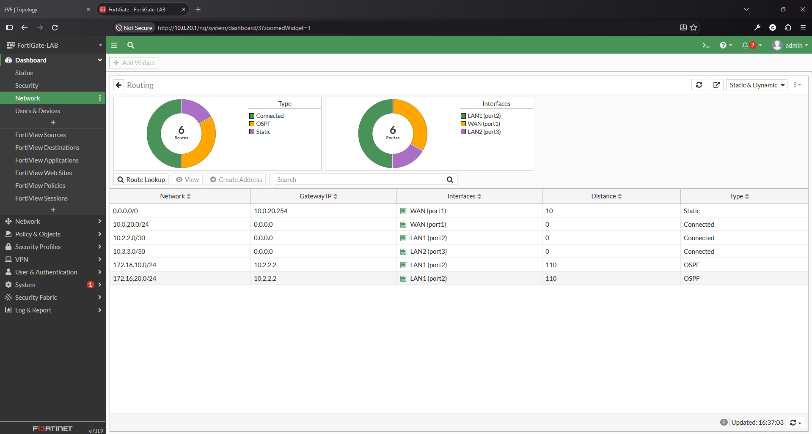

**Firewall policy**

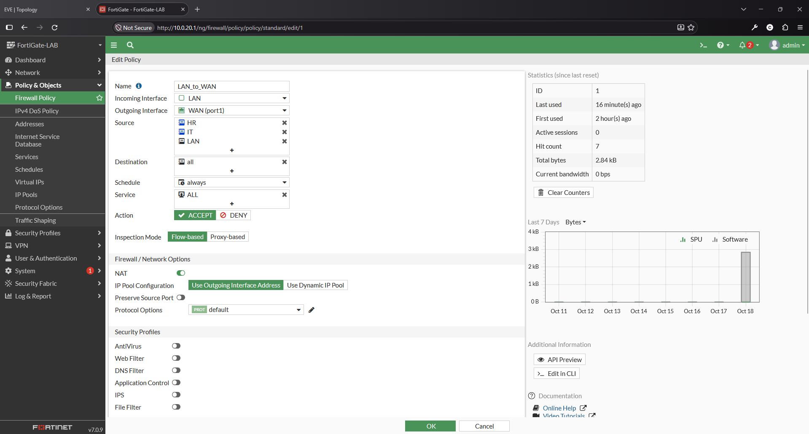

### Clients

**Addresses received from DHCP** (`show ip`)

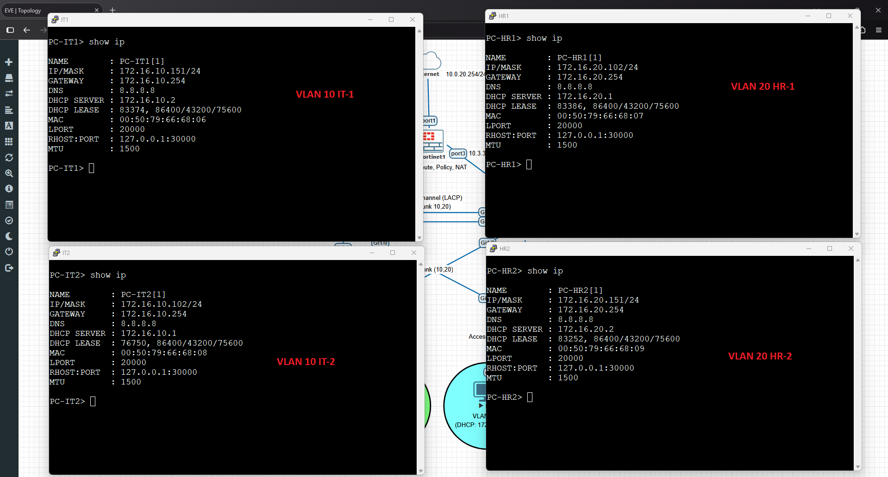

**Internet connectivity** (`ping 8.8.8.8, 1.1.1.1`)

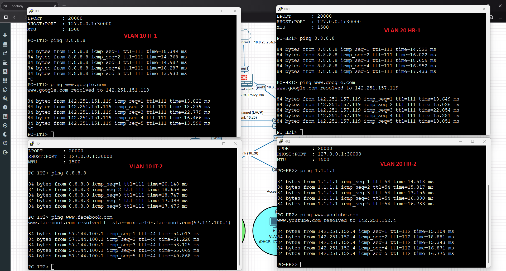

## Repository Structure

```
cisco-fortigate-network-lab/
├── README.md
├── 01-diagrams/        # Network diagram
├── 02-screenshots/     # Command output and test results
└── 03-configs/         # Device configurations (sensitive data redacted)
```

## Possible Improvements

- Deploy the FortiGate as an HA pair to remove the single point of failure at the edge
- Split HSRP Active and STP root per VLAN (VLAN 10 on CORE1, VLAN 20 on CORE2) to share load across both cores
- Add inter-VLAN access control (ACLs on the core SVIs) and per-department firewall policies
- Add a DMZ and a site-to-site IPsec VPN to a branch office

## Author

**Chanathip Artwichian**
GitHub: [@chanathip-awc](https://github.com/chanathip-awc)
